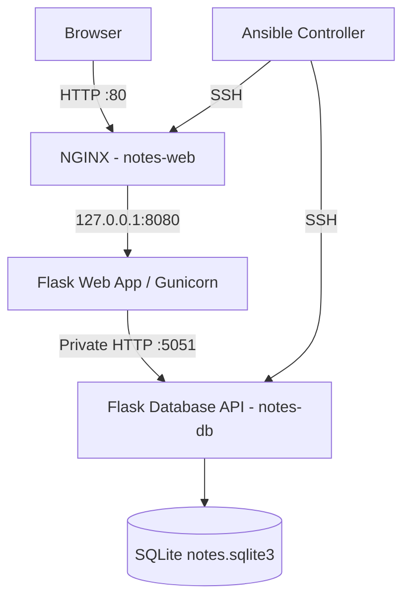

# Ansible Notes Application — AWS DevOps Project

A practical DevOps project that uses **Ansible** to automate the deployment of a Python note-taking application across separate AWS EC2 web and database servers.

## 1. Project Overview

The application allows users to create and view notes through a web interface. Notes are stored in an SQLite database hosted on a separate EC2 instance.

The infrastructure is configured using reusable Ansible roles, Jinja2 templates, systemd services, and encrypted variables managed with Ansible Vault.

### Technologies

- **Cloud:** AWS EC2, Amazon Linux 2023
- **Configuration Management:** Ansible
- **Application:** Python, Flask
- **Web Server:** NGINX
- **Application Server:** Gunicorn
- **Database:** SQLite, exposed through a private Flask API
- **Service Management:** systemd
- **Automation:** Ansible roles, handlers, templates, variables, Vault
- **Version Control:** Git and GitHub

## 2. Architecture

The project uses three EC2 instances.

| Instance | Purpose |
|---|---|
| `ansible-controller` | Executes Ansible playbooks and manages deployments |
| `notes-web` | Hosts NGINX, Gunicorn and the Flask web application |
| `notes-db` | Hosts the private Flask API and SQLite database |



## 3. Application Features

- Create new notes through a browser
- View saved notes and creation timestamps
- Store notes on a separate database server
- Protect the database API using a shared API key
- Run application components as systemd services
- Automatically back up the SQLite database
- Restore and verify database backups
- Deploy infrastructure configuration repeatedly using Ansible

## 4. Project Structure

```text
ansible-notes-project/
├── app/
│   ├── db/
│   │   ├── server.py
│   │   └── requirements.txt
│   └── web/
│       ├── app.py
│       ├── requirements.txt
│       └── templates/
│           └── index.html
├── ansible/
│   ├── deploy.yml
│   └── roles/
│       ├── notes_db/
│       │   ├── defaults/
│       │   ├── files/
│       │   ├── handlers/
│       │   ├── tasks/
│       │   └── templates/
│       └── notes_web/
│           ├── defaults/
│           ├── handlers/
│           ├── tasks/
│           └── templates/
├── docs/
├── tests/
├── .gitignore
└── README.md
```

## 5. Ansible Automation

### Database role: `notes_db`

Configures the database API, dedicated Linux service account, Python environment, SQLite storage, systemd service, and automated backups.

Database backup automation uses a Python backup script and systemd service/timer units.

### Web role: `notes_web`

Installs and configures NGINX, Flask, Gunicorn, application directories, Python dependencies, environment settings, and systemd services.

Handlers restart services when relevant configuration files change.

### Deployment playbook

`ansible/deploy.yml` defines separate plays for the database and web hosts.

Sensitive API credentials are provided through Ansible Vault and are not stored in plaintext in Git.

## 6. Testing and Verification

The following tests were performed successfully in the AWS lab.

| Test | Observed Result |
|---|---|
| Ansible connectivity | Both managed instances returned `pong` |
| Database API health endpoint | HTTP 200 |
| Database service | Active |
| SQLite automated backup | Backup created successfully |
| Backup integrity | SQLite integrity check passed |
| Database restore verification | Passed |
| Web Gunicorn endpoint | HTTP 200 |
| NGINX endpoint | HTTP 200 |
| Public web interface | Accessible through EC2 public IP |
| Create note | Successful |
| Database persistence | Saved note verified on separate EC2 server |
| Ansible web-role idempotence | `changed=0`, `failed=0` |

## 7. Deployment Requirements

A fresh deployment requires:

- Ansible Controller with Ansible installed
- Two reachable Amazon Linux EC2 managed hosts
- Correct SSH connectivity and Python interpreter configuration
- Ansible inventory identifying `web` and `database` groups
- A matching Ansible Vault encrypted API key
- Application and role source files available on the controller

The deployment is launched using `ansible/deploy.yml`. Detailed environment setup and reproducible deployment instructions will be provided in `docs/deployment.md`.

## 8. Troubleshooting Example

During the first web deployment, the application returned HTTP 500 with:

`jinja2.exceptions.TemplateNotFound: index.html`

The problem was traced to the missing HTML template on the managed web server.

The Ansible `notes_web` role was corrected to deploy the HTML file to Flask's expected template directory.

After redeployment:

- The HTML file was present on `notes-web`.
- Flask returned HTTP 200.
- NGINX returned HTTP 200.
- The application successfully created and retrieved notes.

## 9. Security Considerations

This project is an educational AWS lab rather than a production-hardened application.

- SSH private keys are excluded from Git.
- The local SQLite database and backup files are excluded.
- Ansible Vault credentials are excluded.
- Environment files and Python virtual environments are excluded.
- The database API should remain inaccessible from the public internet.
- The current web interface uses HTTP and does not implement end-user authentication.

**Production improvements:** HTTPS/TLS, user authentication, restricted security groups, non-root controller operation, proper IAM roles, secret management, monitoring and automated CI/CD.

## 10. Future Improvements

- AWS dynamic inventory
- Automated deployment tests
- GitHub Actions CI/CD
- HTTPS with a domain name
- Application authentication
- Centralized logs and monitoring
- Improved secret management

## 11. Project Status

**AWS lab deployment completed and verified.**

Web and database services were deployed using Ansible. End-to-end note persistence, database backups, restoration, and web-role idempotence have been tested successfully.